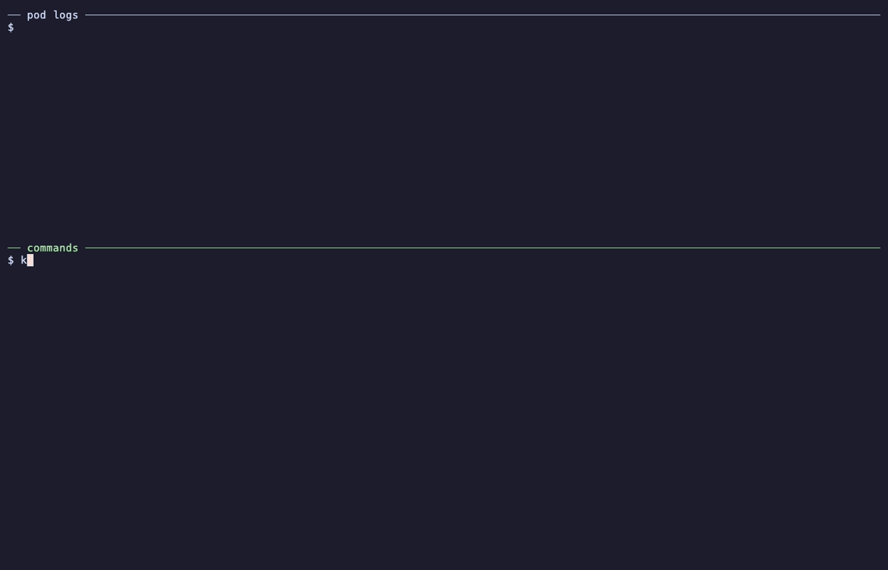
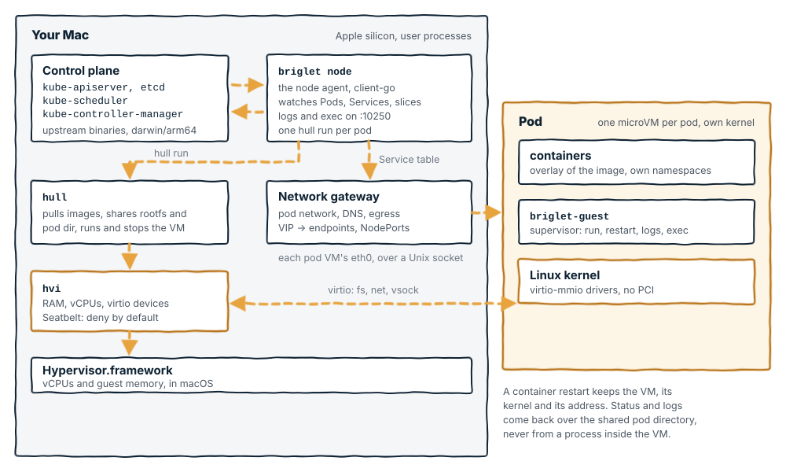

# Briglet

Briglet runs a Kubernetes control plane and node agent natively on Apple
silicon Macs. Each Linux pod runs in a [Hull](https://github.com/brig-sh/hull)
microVM using the hvi backend, with its own kernel. A guest supervisor
manages the pod's containers, while a user-space gateway provides pod
networking and Service routing.

Briglet is experimental. It implements a subset of kubelet behavior and
has documented compatibility gaps.



A pod starts in about a second and a half, runs its own Linux kernel in
a Hull microVM, and is reachable through a Service, all on one Mac. The
access log shows the gateway's address (10.87.0.1) as the client for both
requests: Service traffic is proxied by the gateway, so the server sees the
gateway, not the client pod or the Mac. The recording is scripted in
[docs/demo.tape](docs/demo.tape); see [docs/demo.md](docs/demo.md) to
re-record it.



[docs/architecture.md](docs/architecture.md) follows the code behind
that picture, and adds a second diagram of how a Pod, a Service and a
second node fit together.

## Requirements

- macOS on Apple silicon and Go 1.26.
- etcd 3.7 and Kubernetes 1.37 built for darwin/arm64: kube-apiserver,
  kube-controller-manager and kube-scheduler.
- Hull with the hvi backend, its boot assets, and a gateway that knows
  about Services (`network-gateway --service-cidr`, on Hull's
  `feat/gateway-services` branch until it ships in a release).
- kubectl, for yourself and for the smoke checks (`KUBECTL` overrides).

`hack/fetch-prereqs.sh` fetches or builds all of that into
`~/.local/share/briglet/bin`, where briglet looks by default. What the
script does, how to do it by hand, and the `BRIGLET_BIN_DIR`,
`BRIGLET_K8S_BIN_DIR`, `BRIGLET_ETCD_BIN` and `HULL_BIN` overrides are in
[docs/setup.md](docs/setup.md).

To pull Docker Hub images through Google's mirror, set
`BRIGLET_REGISTRY_MIRROR=mirror.gcr.io` before starting the cluster.

## Start a cluster

```sh
make
bin/briglet up
export KUBECONFIG="$HOME/.briglet/admin.kubeconfig"
kubectl get nodes -o wide
kubectl -n kube-system rollout status deployment/coredns --timeout=180s
bin/briglet status
```

`make` builds the native `bin/briglet` CLI and the static Linux/arm64
`bin/briglet-guest` supervisor. Each pod VM runs the supervisor.
`briglet up` rebuilds a stale supervisor when Go is available and
refuses to start with a missing or stale binary otherwise.

The node reaching Ready and CoreDNS becoming available are separate
events. Wait for CoreDNS before testing cluster DNS.

## Block-device rootfs (experimental)

By default a container runs from an overlay whose lower is the image rootfs
shared read-only over virtio-fs and whose upper is a tmpfs, so a container's
writes use VM memory. With `BRIGLET_ROOTFS_MODE=overlay-block` the VM boots the
base image from hull's overlay-block root and each container image is attached
as a read-only ext4 disk. The container's upper layer is a directory of the
VM's writable disk, which hull keeps per pod and creates sparse, so writes cost
disk and not memory and metadata-heavy work is faster. Pod VMs also boot
faster, about 0.15 s against 0.31 s to `hull run` returning on an M-series
Mac, because hull does not clone the base rootfs.

```sh
brew install e2fsprogs
export BRIGLET_ROOTFS_MODE=overlay-block
export HULL_BIN=/path/to/hull            # built from hull's overlay-block branch
export HULL_BOOT_ASSETS=/path/to/assets  # kernel and block-lower initrd
bin/briglet up
```

The mode needs three things, and the node agent refuses to start without the
first two:

- Homebrew `e2fsprogs`: hull builds each image's ext4 with
  `/opt/homebrew/opt/e2fsprogs/sbin/mke2fs`, once per image digest.
- A hull with `run --image-disk` (hull's `feat/overlay-block-rootfs` plus the
  `--image-disk` commit; `hull run --help` lists the flag).
- Boot assets whose initrd carries the block-lower init. `HULL_BOOT_ASSETS`
  names a directory with `Image`, `container-initrd` and a `provenance.json`
  that matches them. `briglet up` hands it to the gateway, and the node agent
  to every hull it runs. When it is unset hull boots its published bundle,
  which must have that init.

hvi attaches four disks, and the root takes two, so a pod gets two container
images as disks. Containers of the base image run from the root's disk, and
containers of any further image run from the share as before. emptyDir,
ConfigMap, Secret and hostPath volumes stay virtio-fs shares. The supervisor
finds a disk by its virtio-blk serial, `disk<N>`, which is the disk's position
on hvi's command line; the node agent checks hull's `disks.json` for the
instance against what it wrote into `pod.json` before it calls the pod
running. Leave the variable unset, or set it to `share`, for the default.

## Run a pod

```sh
kubectl run web-pod --image=nginx:alpine --port=80
kubectl wait --for=condition=Ready pod/web-pod --timeout=180s
kubectl logs web-pod
kubectl exec -it web-pod -- sh
kubectl delete pod web-pod
```

## Services and DNS

```sh
kubectl create deployment web --image=nginx:alpine --replicas=2 --port=80
kubectl rollout status deployment/web --timeout=180s
kubectl expose deployment web --port=80
kubectl create service nodeport web-np --tcp=8080:80 --node-port=30080
kubectl patch service web-np -p '{"spec":{"selector":{"app":"web"}}}'
kubectl run client --image=busybox -- sleep 3600
kubectl wait --for=condition=Ready pod/client --timeout=180s
kubectl exec client -- wget -qO- http://web
curl http://127.0.0.1:30080/
```

The node agent watches Services and EndpointSlices and updates Hull's
gateway Service table. ClusterIP connections are proxied to ready
endpoints; the backend sees the gateway as the client address. NodePort
Services listen on `0.0.0.0:<nodePort>` on the Mac.

CoreDNS runs as a pod. Pods using ClusterFirst DNS resolve through its
Service at `10.96.0.10`. The Kubernetes Service at `10.96.0.1:443`
reaches the API server on the Mac.

The Mac cannot directly route to pod or ClusterIP addresses. Use a
NodePort or an explicit Hull gateway forward for host access. A gateway
forward is separate from `kubectl port-forward`, which is unsupported.

Inspect the gateway's Service table:

```sh
curl --unix-socket ~/.briglet/gw.sock.api http://gateway/services
```

## Volumes, probes, and containers

Supported volume types include emptyDir, hostPath, ConfigMap, Secret,
downwardAPI, and projected volumes, including service account tokens.
Environment variables can come from ConfigMaps, Secrets, and the
downward API. The agent runs startup, liveness, and readiness probes.

Each pod VM runs `briglet-guest`. It prepares container filesystems and
process namespaces, runs init containers, and manages regular containers
and native sidecars. A container can restart inside the existing VM.

This example uses an init container and two regular containers:

```sh
kubectl apply -f - <<'EOF'
apiVersion: v1
kind: Pod
metadata:
  name: duo
spec:
  initContainers:
  - name: setup
    image: busybox
    command: [sh, -c, 'echo "<h1>hello</h1>" > /work/index.html']
    volumeMounts: [{name: work, mountPath: /work}]
  containers:
  - name: nginx
    image: nginx:alpine
    readinessProbe: {httpGet: {path: /, port: 80}}
    volumeMounts: [{name: work, mountPath: /usr/share/nginx/html}]
  - name: client
    image: busybox
    command: [sh, -c, 'while true; do wget -qO- http://localhost/; sleep 2; done']
  volumes:
  - name: work
    emptyDir: {}
EOF
kubectl wait --for=condition=Ready pod/duo --timeout=180s
kubectl logs duo -c client
kubectl exec -it duo -c client -- sh
```

Native sidecars are declared under `initContainers` with
`restartPolicy: Always`. They differ from the regular companion
container in this example.

Logs support following, previous-container output, timestamps, tail,
time filtering, and byte limits. Exec runs in the selected container's
filesystem, namespaces, user, environment, and working directory.

## More than one node

The controller manager allocates complementary `/25` pod CIDRs, so a
cluster holds two nodes today.

### A second node on the same Mac

A second node agent can use its own state directory and Hull store while
sharing the first agent's gateway:

```sh
bin/briglet join --name node2 --ip 127.0.0.1 --port 10251 \
  --out ~/.briglet-node2/join
mkdir -p ~/.briglet-node2/guest-bin
cp ~/.briglet/guest-bin/briglet-guest ~/.briglet-node2/guest-bin/
BRIGLET_STATE_DIR=~/.briglet-node2 bin/briglet node \
  --kubeconfig ~/.briglet-node2/join/node.kubeconfig \
  --client-ca-file ~/.briglet-node2/join/ca.crt \
  --tls-cert-file ~/.briglet-node2/join/kubelet-serving-node2.crt \
  --tls-private-key-file ~/.briglet-node2/join/kubelet-serving-node2.key \
  --name node2 --node-ip 127.0.0.1 --port 10251 \
  --gateway-sock ~/.briglet/gw.sock --host-ip 10.87.0.1
```

Run the second agent in a separate terminal. Both nodes share one pod
network, so Services, DNS, logs and exec work across them without
anything else.

### A second Mac

A second Mac runs its own node agent and its own gateway, and reaches
the apiserver at the address `briglet join --server-ip` puts in its
kubeconfig. Pod addresses are not routed between Macs; what crosses is
node addresses only. A pod on one Mac reaches a pod on the other
through a Service that has a node port, `kubectl logs` and `exec` reach
pods on either Mac, and each Mac needs a CoreDNS replica of its own.
The recipe, including the macOS code signing and Local Network access
the binaries need, is in [docs/setup.md](docs/setup.md#a-second-mac).

## Compatibility

Briglet is a Kubernetes node whose host is a Mac and whose pods are VMs.
Three things follow from that design and will not change:

- A pod cannot share the host's namespaces. hostNetwork, hostPID and
  hostIPC are rejected.
- Resources are enforced at the VM boundary, not per container. There are
  no cgroups inside the VM, so OOMKilled, in-place resize and cgroup-based
  limits do not exist.
- Pod networking is the gateway's. Pods reach each other, Services and the
  API server; the Mac reaches pods through NodePorts and gateway forwards,
  not by routing to pod addresses.

Everything else is measured, not listed here. The Kubernetes conformance
suite runs against Briglet and [test/conformance/](test/conformance/) holds
the current result, the run recipe, and the skip list with a reason for every
test that cannot pass. That directory is the single place these facts are
kept, so this section does not drift. Briglet is not Kubernetes-certified.

## Development checks

```sh
make test
make
```

Integration checks require the runtime and control-plane dependencies.
They wipe their configured state directories, so use a disposable
`BRIGLET_STATE_DIR` and run them separately from an active cluster.

| Script | Checks |
|---|---|
| `hack/smoke-control-plane.sh` | Native control plane, node registration, and authorization. |
| `hack/smoke-pods.sh` | Pod lifecycle, logs, and exec. |
| `hack/smoke-volumes.sh` | Volumes, environment, probes, and Deployments. |
| `hack/smoke-services.sh` | Services, CoreDNS, and API access. |
| `hack/smoke-containers.sh` | Guest supervisor, init containers, and container restarts. |
| `hack/smoke-multi-node.sh` | Two agents sharing a gateway on one Mac. |

The multi-node check also uses a separate state directory for its second
agent and refuses to run while a Sonobuoy run is active.

## Commands and state

- `briglet up` starts the control plane, gateway, and node agent, then
  applies CoreDNS.
- `briglet down` stops the cluster and removes its pod VMs, keeping state.
- `briglet down --wipe` also removes the state directory.
- `briglet status` prints component health.
- `briglet node` runs the node agent in the foreground.
- `briglet join` creates credentials and prints instructions for another node.

State is stored under `~/.briglet`, or `BRIGLET_STATE_DIR`: credentials,
etcd data, logs, pod records, gateway sockets, and a dedicated Hull store.
Secret volume contents and environment values are staged on disk in this
user-owned directory. Containers receive the values and mounts specified
by their Pod definitions.

The node is named after the Mac's short hostname. Set `BRIGLET_NODE_NAME`
before the first `briglet up` to choose another name; the name is in the
node's certificates, so changing it later needs `briglet down --wipe`.

The node's InternalIP is the address of the interface that holds the
default route. Set `BRIGLET_NODE_IP` to pick another one, for instance on
a Mac with a second network that other nodes cannot reach.

## Documentation

- [docs/setup.md](docs/setup.md): prerequisites, where briglet looks for
  them, and the first cluster.
- [docs/architecture.md](docs/architecture.md): the two diagrams, the
  processes on the Mac, the node agent, the pod VM and its supervisor,
  Services and DNS, more than one node, and what is not implemented.
- [CONTRIBUTING.md](CONTRIBUTING.md): checks, commit conventions and the
  DCO.

## License

Apache License 2.0, see [LICENSE](LICENSE).
