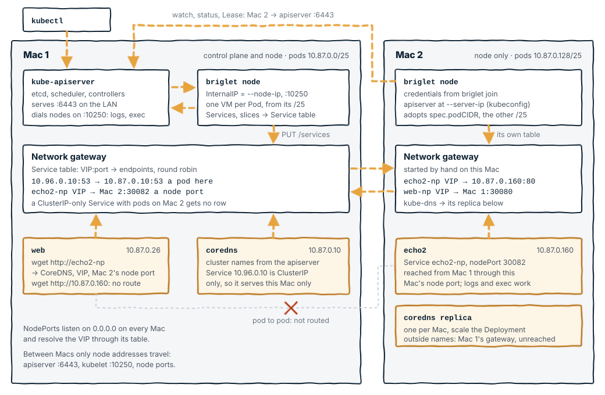

# How briglet works

briglet makes a Mac a Kubernetes node without a Linux node VM in between.
The control plane and the node agent are native macOS processes. Every
pod is one Linux microVM, started through [hull](https://github.com/brig-sh/hull)
on the hvi backend, with a small supervisor inside that runs the pod's
containers. A user-space gateway process gives the VMs their network,
routes Service addresses, and is the only path from the Mac into the pod
network.

This document follows the code. File names refer to this repository.

## At a glance

The programs behind one pod, and where each sits in the stack:


How a Pod, a Service and a second node fit together:



## Processes on the Mac

`briglet up` (internal/cp/cp.go) creates the state directory, the PKI and
the kubeconfigs, runs every component's preflight check, then starts the
processes in this order and waits for each to be ready before the next:

| Process | Listens on | Ready when |
|---|---|---|
| etcd, single member | `127.0.0.1:2379` (clients), `:2380`, `:2381` | `/health` answers |
| kube-apiserver | `0.0.0.0:6443`, advertise address `10.87.0.1` | `/readyz` answers; the addons are then applied |
| kube-controller-manager | `127.0.0.1:10257`, cluster CIDR `10.87.0.0/24`, node mask `/25` | `/healthz` |
| kube-scheduler | `127.0.0.1:10259` | `/healthz` |
| `hull network-gateway` | unix sockets `gw.sock`, `gw.sock.api` | `GET /forwards` on the API socket |
| `briglet node` | `:10250`, the node's LAN IPv4 or `127.0.0.1` | kubelet `/healthz`, Node `Ready`, no not-ready taint |

Each process runs detached in its own session with a pid file under
`run/` and a log under `logs/`. A later `briglet up` adopts a process
that is still alive instead of starting a second one, and refuses to
start when a port is held by something briglet did not start
(internal/cp/proc.go).

The PKI (internal/cp/pki.go) is an ECDSA P-256 CA with one-year leaf
certificates for the apiserver, its etcd and kubelet clients, etcd, the
controller manager, the scheduler, the admin user and the node. Leaves
are reissued when they near expiry or their SANs change. The apiserver
certificate covers `10.96.0.1`, `10.87.0.1` and the Mac's LAN addresses,
so pods and other nodes can reach it.

`briglet down` stops the processes in reverse order and removes the pod
VMs. `--wipe` also detaches hull's store image and deletes the state
directory.

## The node agent

The agent (internal/node) is written against client-go. It does what the
kubelet does for the behaviors briglet supports, and nothing else.

- It registers the Node with `kubernetes.io/os=linux` and
  `kubernetes.io/arch=arm64`, which is what workloads and the CoreDNS
  addon select on, and `briglet.io/host-os=darwin` for the host. Capacity
  is the Mac's CPU count, its memory minus 2 GiB, and 110 pods. It renews
  a Lease every 10 s and pushes node status at the same rate
  (agent.go).
- It watches the Pods bound to it, every Service, EndpointSlices and
  Nodes, and one ConfigMap or Secret informer per object a pod mounts
  (pods.go, sources.go).
- It serves the kubelet endpoints the apiserver uses, over mTLS against
  the cluster CA: `/healthz`, `/pods`, `/containerLogs/...` and
  `/exec/...` with the WebSocket and SPDY protocols (server.go, logs.go,
  exec.go). Attach, port-forward, stats and metrics are not served.
- Probes: exec probes run through hull's guest agent; HTTP probes go
  through a temporary gateway forward; TCP probes use the gateway's
  `/probe/tcp`. A probe at its failure threshold asks the guest
  supervisor to restart the container (probes.go).
- It runs the apiserver's egress proxy, a CONNECT server on
  `egress.sock`. Addresses in the Service CIDR or this node's pod CIDR
  get a temporary gateway forward; loopback, the node's own address and
  everything else are dialed directly (egressproxy.go).
- Pod status is rebuilt from the supervisor's `status.json`. The agent
  keeps `pods/<uid>/state.json`, so a restarted agent adopts VMs that are
  still running. A VM that dies under running containers reports exit
  137; the pod is rebooted or marked Failed according to its restart
  policy (podstatus.go, podwatch.go).

## From Pod to VM

Starting a pod (internal/node/podstart.go, internal/podvm):

1. Allocate an address from the node's pod CIDR. The allocation lives in
   `ipam.json` under a file lock and goes round-robin, so a just-freed
   address is not reused while the gateway still holds its ARP entry.
2. Stage the volumes under `pods/<uid>/guest/volumes`. ConfigMap,
   Secret, downwardAPI and projected volumes are written atomically and
   refreshed when their sources change; service account tokens are
   refreshed before they expire. emptyDir is a directory there, or a
   tmpfs in the guest for the memory medium.
3. Pull the images through hull, one at a time. Each image rootfs is
   shared read-only into the VM; the agent reads the image config
   itself to build the container's argv, environment, user and working
   directory.
4. Write `pod.json`, the whole pod as the supervisor sees it, including
   every container's environment. Secrets travel in this file, mode
   0600, inside the user-owned state directory.
5. `hull run --detach --hypervisor hvi` with the pod's address, the
   shared directories, and memory and CPUs sized from the containers'
   limits (defaults 1 CPU and 512 MB each, plus 64 MB for the VM). The
   VM boots a small base image and runs
   `briglet-guest run /run/briglet/pod.json`.

Stopping a pod sends `stop` to the supervisor, waits for the grace
period, then `hull stop` and `hull rm`, and releases the address, the
forwards and the pod directory.

## Inside the VM

`briglet-guest` (cmd/briglet-guest, internal/guest) is a static
linux/arm64 binary and the VM's pid 1 for practical purposes. It reads
`pod.json`, sets the hostname, `/dev/shm` and the pod's sysctls, opens
its control socket, and runs the containers:

- Each container gets a mount namespace, and a pid namespace unless the
  pod shares one. Its root is an overlay of the read-only image with a
  tmpfs upper layer, entered with `pivot_root`. `/proc`, `/sys` and
  `/dev` are mounted, `/etc/hosts` and the like are bind-mounted from
  the pod directory, sensitive paths are masked, the bounding capability
  set is cut to the kubelet's default fourteen, `no_new_privs` is set,
  and the process switches to the container's uid and gid before exec
  (container_linux.go, caps_linux.go). Containers share the VM's network
  namespace, which is the pod's.
- Init containers run one at a time; a sidecar (an init container with
  `restartPolicy: Always`) has to be running before the next one starts.
  Regular containers follow the pod's restart policy with the kubelet's
  back-off, and restarting one keeps the VM, its kernel and its address.
  When the regular containers are done the sidecars are stopped in
  reverse order and the VM powers off (supervisor_linux.go).
- Logs are written in CRI format to `logs/<container>.log` on the shared
  pod directory, so the agent on the Mac serves them without entering
  the VM. `status.json` next to them carries container states and exit
  codes.
- `exec` enters the container's mount and pid namespaces with `setns`,
  drops to its credentials and runs the command; the agent reaches it
  through hull's guest agent socket (exec_linux.go).
- The control socket takes `restart`, `kill` and `stop` for one
  container (ctl_linux.go, proto.go).

## Services and DNS

The gateway keeps a Service table: one entry per ClusterIP, port and
protocol, with the ready endpoints behind it. The agent builds the table
from Services and EndpointSlices (internal/services/table.go) and PUTs it
to the gateway after a 200 ms debounce, then re-reads and re-puts it
every 30 s (sync.go). ClusterIP connections from a pod are proxied by
the gateway to an endpoint, which sees the gateway as the client.
Headless, ExternalName, SCTP and non-IPv4 Services are left out.

Each ready endpoint address becomes one of four things, or is skipped
(table.go):

| Endpoint | Table entry |
|---|---|
| the `kubernetes` Service | the apiserver at the address in this node's kubeconfig, dialed from the Mac |
| the gateway's own address | `127.0.0.1:<port>` on the Mac |
| an address in this node's pod CIDR | the pod, through the pod network |
| a pod on another node, when the Service has a node port | that node's InternalIP and the Service's node port, dialed from the Mac |
| a pod on another node, ClusterIP only | skipped; the agent logs `services: skipping endpoint` |

NodePort and LoadBalancer Services become a gateway forward from
`0.0.0.0:<nodePort>` on the Mac to the Service address, so the table
picks the endpoint, local or stitched. That is also what makes the
fourth row work: a node port answers on every node.

CoreDNS runs as an ordinary pod from the addon manifest, forwarding
outside names to the first node's gateway address. Pods with
`ClusterFirst` DNS get its Service address `10.96.0.10` in
`resolv.conf`; the agent writes that file, `hosts` and `hostname` into
the pod directory. The `kube-dns` Service is ClusterIP only, so a node
without a CoreDNS replica of its own has no cluster DNS; scale the
Deployment to one replica per node.

The Mac itself has no route to pod or Service addresses. Reaching a pod
from the host goes through a NodePort or a gateway forward.

## State directory and environment

Everything lives under `~/.briglet`, or `BRIGLET_STATE_DIR`:

```
pki/  etcd/  logs/  run/  kubeconfig/  admin.kubeconfig
egress-selector.yaml  egress.sock
gw.sock  gw.sock.api  gw.sock.qemu
hull-store/            a case-sensitive APFS image hull mounts here
pods/<uid>/state.json  the agent's record of the pod
pods/<uid>/guest/      pod.json, status.json, ctl.sock, etc/, logs/, volumes/
ipam.json              pod address allocation
guest-bin/             the briglet-guest every VM shares
image-links/           colon-free symlinks to image rootfs directories
join/<name>/           credentials minted by briglet join
```

| Variable | Meaning | Default |
|---|---|---|
| `BRIGLET_STATE_DIR` | state directory; also required for `down --wipe` outside `~/.briglet` | `~/.briglet` |
| `BRIGLET_BIN_DIR` | where the prerequisites live, see [setup.md](setup.md) | `~/.local/share/briglet/bin` |
| `BRIGLET_K8S_BIN_DIR`, `BRIGLET_ETCD_BIN` | name the control plane binaries outright | unset |
| `HULL_BIN` | the hull binary | `BRIGLET_BIN_DIR/hull`, then `PATH`, then the cask |
| `BRIGLET_BASE_IMAGE` | image every pod VM boots | `busybox:latest` |
| `BRIGLET_REGISTRY_MIRROR` | Docker Hub mirror host | unset |
| `BRIGLET_DEBUG` | log the service table on every change | off |

## More than one node

`briglet join` mints a node identity and a kubeconfig for a second agent
and prints how to start it. Pod CIDRs are the two `/25` halves of the
cluster `/24`, so a cluster holds at most two nodes today; the agent
adopts `spec.podCIDR` on startup.

On the same Mac the second agent uses its own state directory and hull
store and shares the first agent's gateway (`--gateway-sock`, with
`--host-ip` set to the gateway's address). Both nodes then sit on one
pod network, so every table row above is local and nothing is stitched.
`hack/smoke-multi-node.sh` exercises that, with Services, DNS, logs and
exec crossing between the two nodes.

On a second Mac the agent runs against a gateway of its own, started by
hand on that Mac, and reaches the apiserver at the address `briglet
join --server-ip` put in its kubeconfig. Nothing routes pod addresses
between Macs. What crosses is only node addresses: the apiserver port
(watches, status, the Lease), the kubelet port (logs, exec, probes from
the apiserver) and node ports (Service traffic, stitched as in the table
above). A pod on Mac 1 reaches a pod on Mac 2 through a Service that
has a node port, and not otherwise; the reverse holds too. The recipe,
including the macOS signing and Local Network requirements, is in
[setup.md](setup.md#a-second-mac).

## What is not there

The design limits are three: a pod cannot share the host's namespaces,
resources are enforced at the VM boundary rather than per container, and
the Mac does not route to pod addresses. The README's Compatibility section
states them. Every other gap is a measured one: the conformance run in
[../test/conformance/](../test/conformance/) keeps the current list, with a
reason per skipped test, and is updated with each run. Two architecture
notes that no conformance test covers:

- Two agents sharing one gateway each PUT their own view of the Service
  table; nothing coordinates them beyond last writer wins.
- The CoreDNS addon forwards outside names to the first node's gateway
  address; a replica on another Mac answers cluster names but cannot
  reach that upstream.

Known issues seen on a two-Mac cluster, not fixed yet:

- After the agent's connection to the apiserver drops and comes back,
  its Pod watch can sit on the dead connection until the watch times
  out, a few minutes in which a newly bound Pod stays Pending.
- A pod deletion that fails against the apiserver is not retried; the
  Pod stays Terminating until it is deleted with `--force`.
- The gateway's netstack mishandles a `/25` subnet; a second Mac's
  gateway runs on the full `/24` with its own half's first address as
  the gateway address.
